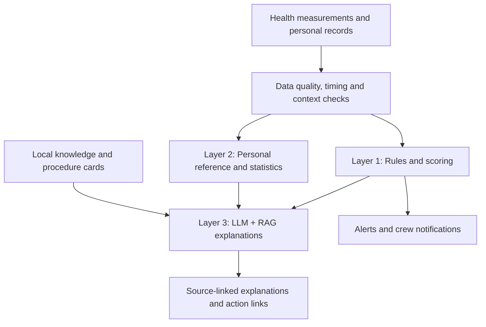

# Astro Hiyoko — Astronaut Health Monitoring Software

**English** | [繁體中文](README.zh-TW.md)

Astro Hiyoko is shipboard health monitoring software designed for space missions. It helps astronauts collect health indicators, understand changes in their own health and take follow-up action through reminders, health information and crew coordination. The project responds to the NASA Space Apps challenge [Create Health Monitoring Software for Astronauts on Space Missions](https://www.spaceappschallenge.org/2026/challenges/health-monitoring-software/).

Our proposed three-layer analysis architecture combines **rule-based assessment, personalized statistical analysis and AI explanations grounded in evidence**. Crew members manage their records in a personal app, monitoring staff review the whole crew at a monitoring station, and a shared board displays the latest readings and alerts.

The current prototype runs locally, stores measurements in SQLite and provides five fictional crew accounts for training with manual entries and synthetic sensor data.

## What the health system does

| Feature | What crew members and monitoring staff can do |
| --- | --- |
| Vital-sign monitoring | Record heart rate, oxygen saturation, blood pressure and temperature. Review each reading's time, source, measurement method and data quality. |
| Personal health trends | Explore changes over different periods, compare readings by source and method, and open the original measurements. |
| Personalized statistical analysis | Compare readings with personal history. Use Z-scores and an exponentially weighted moving average (EWMA) to examine deviations and sustained changes. |
| NEWS2 observation records | Assemble physiological measurements, consciousness and oxygen information for one observation. Save partial entries and identify missing or unusable inputs. |
| Daily health management | Log exercise time, complete measurements and post-exercise self-assessments, receive reminders, and review personal badges and team completion counts. |
| Health assistant | Ask about personal records, training and alerts in English or Traditional Chinese. Follow up on an answer and open the original evidence it cites. |
| Help requests and automatic alerts | Notify crewmates and the monitoring station with one tap. Use a designated synthetic heart-rate scenario to demonstrate automatic alerts. |
| First-aid knowledge and procedure cards | Read local bilingual training materials and open relevant guidance from a health question or help-request scenario. |
| Crew monitoring and shared display | Review crew measurement history and notifications at the station. Show the latest readings and alerts on a read-only shared screen. |
| Local operation and storage | Save records locally and synchronize screens through live updates. Local summaries, training materials and crew alerts remain available when the cloud model is unavailable. |

The full data catalog defines **33 monitoring items** across emergency monitoring (12), daily health (9) and long-term monitoring (12). The current main measurement workflow supports heart rate, oxygen saturation, blood pressure and temperature. The remaining catalog entries guide further expansion.

## Three-layer health analysis architecture

| Layer | Purpose | Processing and output |
| --- | --- | --- |
| **Layer 1 — Rule-based assessment** | Check whether readings meet specified conditions and whether an assessment has sufficient data. | Check data quality, timing and context before applying versioned rules. The design includes a NEWS2 component and total-score interface, alert reasons, triggering evidence and associated procedures. |
| **Layer 2 — Personalized statistical analysis** | Understand how a reading differs from that crew member's usual state. | Establish a reference from historical readings with matching sources, methods and contexts. Calculate Z-scores to express deviations and use EWMA to examine sustained changes. |
| **Layer 3 — LLM + RAG explanations** | Turn measurements, assessment results and retrieved knowledge into explanations crew members can understand. | Retrieve authorized personal records and local documents. Explain observations, reasons and missing data, provide relevant action links, and attach traceable sources. |

Layer 1 uses explicit rules to identify conditions that need attention. The NEWS2 design draws on six physiological parameters and supplemental oxygen information. The system first checks input completeness, then uses an enabled scoring configuration for calculation. [Royal College of Physicians NEWS2 reference](https://www.rcp.ac.uk/resources/national-early-warning-score-news-2/)

Layer 2 accounts for individual differences. The same heart rate can represent different deviations for two crew members. A Z-score expresses the difference from a personal mean in standard deviations. EWMA smooths successive deviations to help reveal whether a change persists.

Layer 3 uses a large language model (LLM) with retrieval-augmented generation (RAG) to explain the evidence. A crew member can ask which record supports an explanation or what is missing from an assessment, then open the referenced record or procedure card.

The diagram shows the proposed flow between the three layers.



### Current implementation

- **Layer 1** includes synthetic heart-rate alerts, NEWS2 observation records, and completeness and quality checks. The NEWS2 score remains empty while its scoring configuration is awaiting activation.
- **Layer 2** compares readings with matching data from the preceding seven days and calculates Z-scores and EWMA. Formal reference approval, freezing and rebuilding remain part of the architecture roadmap.
- **Layer 3** provides personal-record queries, local knowledge retrieval, citations and model-answer verification. Full integration of all three layers' outputs remains an expansion of the design.

## Start the health system on Windows

Install Python 3.12 and Node.js 24 with npm. From the repository root, run these commands in PowerShell.

```powershell
.\health-system\setup.cmd
.\health-system\start.cmd
```

The first command installs dependencies and builds the web app. On subsequent runs, only the second command is needed. Keep that window open while using the system. The default training password for all accounts is `orbital-demo`.

| Local page | Sign in as | What you see |
| --- | --- | --- |
| [Crew app](http://127.0.0.1:8000/app) | `mira`, `kai`, `lin`, `noa` or `sol` | Your measurements, trends, daily training and help button |
| [Monitoring station](http://127.0.0.1:8000/system) | `monitor` | All five crew members, their measurement history and incoming alerts |
| [Read-only board](http://127.0.0.1:8000/board) | `display` | Latest crew readings and alerts for a shared screen |

### Try a first measurement

1. Open the crew app as `mira`. In a separate browser profile, open the monitoring station as `monitor` so both sessions stay signed in.
2. In Mira’s app, select **Record measurement → Blood pressure**. Enter a sample such as `118/76 mmHg`, check the time and posture, then preview and save.
3. Watch Mira’s row update at the monitoring station. Open her history to inspect the saved measurement. To try an alert, select **Request help** on Mira’s overview and watch the station show her name and the event time.

For sensor simulation, offline operation and detailed feature instructions, see the [health system guide](health-system/README.md).

## Optional demo in the 3D habitat

The 3D website shows how the medical software could be used inside a spacecraft. The five crew phones open their owners’ health apps, and the commons wall displays the shared health board.

Leave the medical service running. In a second PowerShell window, start at the repository root and run the following commands. Use a browser with WebGL 2 support.

```powershell
cd .\astro-hiyoko-demo
npm.cmd ci      # First run only
npm.cmd start
```

Open the [connected cabin](http://127.0.0.1:4173/) in two browser windows. In the first, use **Go to area** to enter the commons and wait for **Live** on the wall. In the second, select **Mira** under **Crew devices** and tap **Request help**. The wall shows **Mira · Manual help request** and the event time.

With only the 3D service running, you can also explore four scripted scenarios. Press **F** to choose one. Stop each running service with `Ctrl+C` in its PowerShell window. [Standalone simulation](http://127.0.0.1:4173/?mode=simulation) · [3D demo guide](astro-hiyoko-demo/README.md)


## Added features and demonstration datasets

- **Space radiation monitoring:** personal views show prior exposure, shared increment and total; monitoring staff can view all five crew and control simulated events. The cabin's **More → Open radiation monitor** reads the same persisted backend mission. Reloading does not reset exposure. All radiation values are Simulation.
- **Historical dataset import:** sign in as `monitor`, open `/system`, choose a JSON file, review its summary and import it. Measurements, body scans and radiation archives are supported. Imported radiation archives are displayed separately from the live mission.
- **Telemetry playback fallback:** start the medical and cabin services, then open `http://127.0.0.1:4173/playback.html` to loop synthetic readings into the crew phones and shared board. Stopping playback lets readings become stale while preserving history.

| File | Purpose |
| --- | --- |
| [60-second dataset](astro-hiyoko-demo/data/crew-health-sample60.zip) | Five-crew synthetic telemetry loaded directly by the player: 300 packets and 1,215 metrics per cycle. Demonstrates the data flow without hardware; it is not the historical JSON import format. |
| [Historical JSON example](health-system/examples/crew-dataset.example.json) | Select this file in the monitoring station's dataset importer to demonstrate the `crew-dataset/1` historical format. |

`health-system/backend/radiation*.py` implements accumulation, persistence and APIs; `dataset_import.py` and `body_import.py` handle imports. `RadiationPanel.tsx` and `DatasetImport.tsx` provide the medical UI; `astro-hiyoko-demo/radiation-monitor.js` connects the cabin display. See the [health-system guide](health-system/README.md) and [cabin guide](astro-hiyoko-demo/README.md).
