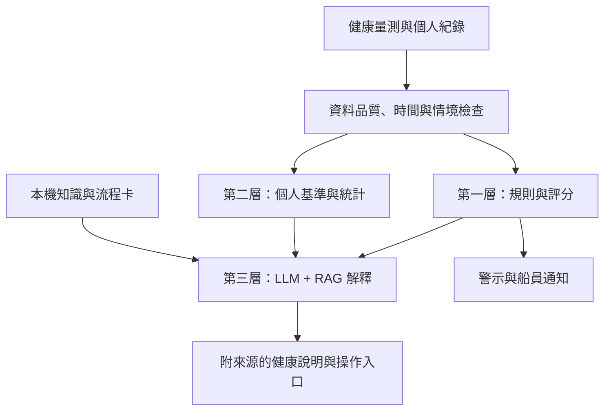

# Astro Hiyoko 太空人健康監測軟體

[English](README.md) | **繁體中文**

Astro Hiyoko 是為太空任務設計的船內健康監測軟體，協助太空人收集健康指標、理解個人健康變化，並透過提醒、健康資訊與船員協作採取後續行動。本專案回應 NASA Space Apps 的競賽題目 [Create Health Monitoring Software for Astronauts on Space Missions](https://www.spaceappschallenge.org/2026/challenges/health-monitoring-software/)。

我們提出三層健康分析架構，結合**規則評估、個人化統計分析，以及具來源依據的 AI 解釋**。船員可以使用個人端管理健康紀錄，監測人員可從系統總覽掌握全隊狀況，共用看板則呈現最新量測與緊急通知。

目前原型在本機運作，以 SQLite 儲存量測紀錄，提供五個虛構船員帳號，使用人工登錄與合成感測資料展示操作流程。

## 醫療系統能做什麼

| 功能 | 船員與監測人員可以做什麼 |
| --- | --- |
| 生命徵象監測 | 登錄心率、血氧、血壓與體溫，查看量測時間、來源、方法及資料品質。 |
| 個人健康趨勢 | 查看不同期間的變化，依來源及量測方法比較，點開原始紀錄追溯數值。 |
| 個人化統計分析 | 以自己的歷史資料作為比較基準，透過 Z-score 與指數加權移動平均（EWMA）觀察偏離程度及持續變化。 |
| NEWS2 觀察紀錄 | 整理同次觀察的生理資料、意識與補氧資訊，保存部分填寫結果，標示缺項及不可用資料。 |
| 每日健康管理 | 記錄運動時間、完成量測與運動後自評，接收提醒，查看個人徽章和團隊完成度。 |
| 健康助手 | 用英文或繁體中文詢問個人紀錄、訓練及警示，追問回答內容，開啟所引用的原始證據。 |
| 求助與自動通知 | 一鍵通知其他船員及監測站，也能透過指定合成心率情境展示自動警示。 |
| 急救知識與流程卡 | 查閱本機雙語教材，從健康問題或求助情境開啟相關內容。 |
| 全隊監測與共用看板 | 監測站查看全員量測歷史與通知，共用螢幕顯示最新健康狀況。 |
| 本機運作與資料保存 | 在本機保存健康紀錄，透過即時更新同步各畫面。雲端模型無法使用時，仍提供本機摘要、教材與船內通知。 |

完整資料目錄規劃了 **33 項監測項目**，涵蓋緊急監測 12 項、每日健康 9 項及長期監測 12 項。目前主要量測流程已啟用心率、血氧、血壓與體溫，其餘目錄提供後續擴充方向。

## 三層健康分析架構

| 層級 | 設計目的 | 處理方式與輸出 |
| --- | --- | --- |
| **第一層 — 規則與評分**（Rule-based Assessment） | 檢查量測是否符合指定條件，以及評估資料是否足夠。 | 檢查資料品質、時間及適用情境，再執行版本化規則。設計包含 NEWS2 分項與總分計算介面，以及警示原因、觸發證據和對應流程。 |
| **第二層 — 個人基準與趨勢**（Personalized Statistical Analysis） | 了解這次數值相對於這位船員平常狀態的變化。 | 以相同來源、方法及情境的歷史資料建立比較基準，使用 Z-score 衡量偏離程度，以 EWMA 觀察連續變化。 |
| **第三層 — AI 解釋與知識檢索**（LLM + RAG） | 將量測、評估結果與知識來源轉成船員能理解的說明。 | 檢索授權的個人紀錄及本機文件，整理觀察、原因、缺少資料與相關操作入口，並附上可追溯的來源。 |

第一層採用明確規則辨識需要注意的情況。NEWS2 的設計依據包含六項生理參數及補氧資訊，系統會先確認所需資料的完整性，再依啟用的評分設定計算。[RCP NEWS2 官方說明](https://www.rcp.ac.uk/resources/national-early-warning-score-news-2/)

第二層加入個人差異。例如，同樣的心率數值，相對於不同船員的歷史紀錄，可能有不同程度的偏離。Z-score 表示與個人平均值相差幾個標準差，EWMA 則平滑連續的偏離值，協助觀察變化是否持續。

第三層結合大型語言模型（LLM）與檢索增強生成（RAG），把這些證據整理成可閱讀的回答。船員能追問「哪筆紀錄支持這個說明？」或「這次評估還缺什麼？」，並直接開啟相關紀錄或流程卡。

下圖呈現我們提出的三層資料處理流程。



### 目前實作進度

- **第一層**已實作合成心率規則通知，以及 NEWS2 觀察紀錄、缺項與品質檢查。NEWS2 總分目前保留空值，評分設定尚未啟用。
- **第二層**已提供前七天同條件資料的比較，以及 Z-score／EWMA 計算。完整的基準審核、凍結與重建流程仍屬架構規劃。
- **第三層**已提供個人紀錄查詢、本機知識檢索、引用與模型回答驗證。設計中的完整三層結果整合仍可持續擴充。

## 在 Windows 啟動醫療系統

先安裝 Python 3.12 與含 npm 的 Node.js 24。在儲存庫根目錄開啟 PowerShell，執行以下指令。

```powershell
.\health-system\setup.cmd
.\health-system\start.cmd
```

第一行安裝套件並建置網頁，之後啟動只需執行第二行。使用期間請保持此視窗開啟。所有帳號的預設訓練密碼都是 `orbital-demo`。

| 本機入口 | 登入帳號 | 畫面內容 |
| --- | --- | --- |
| [船員個人端](http://127.0.0.1:8000/app) | `mira`、`kai`、`lin`、`noa` 或 `sol` | 個人量測、趨勢、每日訓練與求助按鈕 |
| [監測站](http://127.0.0.1:8000/system) | `monitor` | 五位船員的健康狀況、量測歷史與緊急通知 |
| [唯讀看板](http://127.0.0.1:8000/board) | `display` | 適合共用螢幕的全隊最新讀值與通知 |

### 試著記錄第一筆量測

1. 用 `mira` 登入船員個人端，再用另一個瀏覽器設定檔，以 `monitor` 登入監測站，讓兩個帳號同時保持登入。
2. 在 Mira 的個人端選擇「新增量測 → 血壓」，輸入一筆示範值，例如 `118/76 mmHg`。確認時間與姿勢後，預覽並儲存。
3. 在監測站查看 Mira 那一列的新讀值，點開量測歷史即可核對原始紀錄。若要體驗通報，在 Mira 的個人總覽按「緊急求助」，監測站會顯示她的名字與事件時間。

感測器模擬、離線操作與各功能的詳細步驟，請見[醫療系統使用指南](health-system/README.zh-TW.md)。

## 選用的 3D 船艙展示

3D 網站呈現醫療軟體在太空船裡的使用情境。五支船員手機各自開啟本人的健康系統，公共區牆面則顯示全隊共用的健康看板。

保持醫療服務運作，從儲存庫根目錄另開一個 PowerShell 視窗，執行以下指令。請使用支援 WebGL 2 的瀏覽器。

```powershell
cd .\astro-hiyoko-demo
npm.cmd ci      # 僅首次執行
npm.cmd start
```

在兩個瀏覽器視窗開啟 [3D 船艙](http://127.0.0.1:4173/)。第一個視窗透過「前往艙區」進入公共區，等牆面顯示「已連線」。第二個視窗從「船員裝置」選擇 Mira，按下「緊急求助」。公共區牆面會顯示「Mira · 主動求助」與事件時間。

若只啟動 3D 服務，也可進入獨立模擬，按 **F** 選擇四種預設情境之一。展示結束後，在各服務的 PowerShell 視窗按 `Ctrl+C` 停止服務。[獨立劇本模式](http://127.0.0.1:4173/?mode=simulation) · [3D 展示操作指南](astro-hiyoko-demo/README.zh-TW.md)


## 新增功能與展示資料

- **太空輻射監測**：個人頁顯示歷史暴露、共同新增與合計；監測站可查看五人並切換模擬輻射事件。3D 船艙的「更多 → 開啟輻射監測」讀取同一份後端資料，重新整理不會歸零。所有輻射數值均為 Simulation。
- **歷史資料匯入**：以 `monitor` 登入醫療系統的 `/system`，選取 JSON、確認摘要後匯入。可匯入生命徵象、身體掃描與輻射封存資料；匯入的輻射封存與即時任務分開顯示。
- **即時資料播放備案**：啟動醫療與 3D 服務後，開啟 `http://127.0.0.1:4173/playback.html` 開始循環播放，讓五人手機與公共看板持續收到合成量測。停止後讀值會逐漸過期，歷史仍保留。

| 檔案 | 用途 |
| --- | --- |
| [60 秒資料包](astro-hiyoko-demo/data/crew-health-sample60.zip) | 資料播放器直接讀取的五人合成遙測；每輪 300 包、1,215 筆指標。供無硬體時展示資料流，不是歷史 JSON 匯入檔。 |
| [歷史 JSON 範例](health-system/examples/crew-dataset.example.json) | 在監測站的資料匯入功能選取，示範 `crew-dataset/1` 格式的歷史資料。 |

程式分工：`health-system/backend/radiation*.py` 負責輻射累加、保存與 API；`dataset_import.py`、`body_import.py` 負責匯入；`health-system/web/src/RadiationPanel.tsx`、`DatasetImport.tsx` 提供操作介面；`astro-hiyoko-demo/radiation-monitor.js` 將輻射資訊接入船艙。操作細節見[醫療系統 README](health-system/README.zh-TW.md)與[3D README](astro-hiyoko-demo/README.zh-TW.md)。
## 硬體模擬

- **Wokwi 電路模擬：** 以 ESP32 為基礎的生理感測系統互動式模擬，包含感測器接線與韌體程式。

  [Wokwi 模擬專案](https://wokwi.com/projects/480433596780917761)
