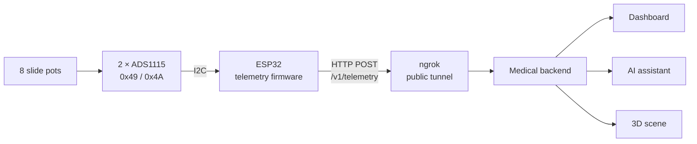
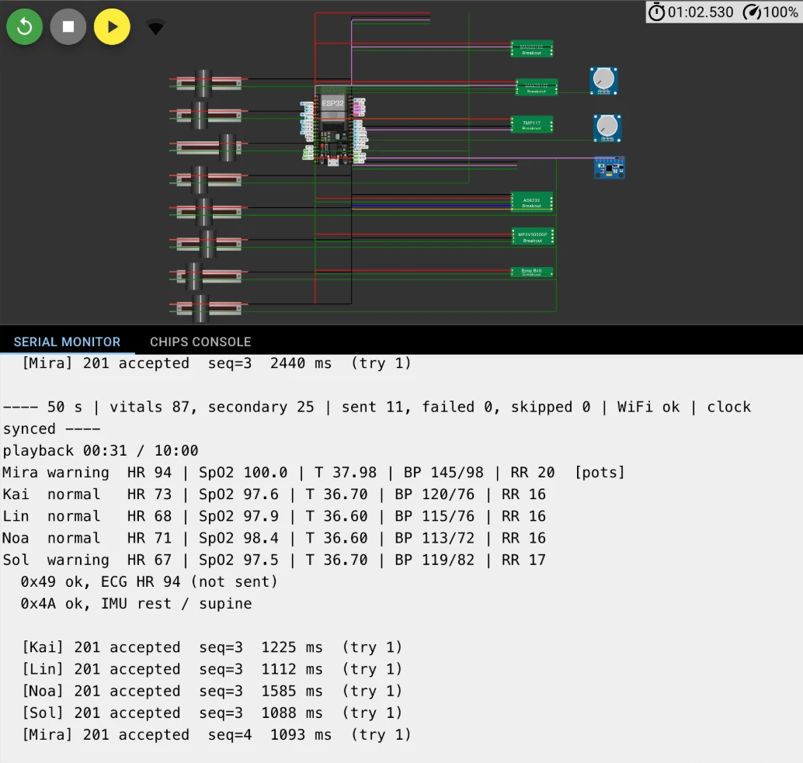

# Telemetry Firmware and Backend Integration

English | [繁體中文](README.zh-TW.md)

> Draft · 2026-11-15 · Author: Abby
>
> Sensor selection, the Wokwi circuit, the sensing firmware and the classification rules are covered in Samreena's "Biomedical Sensing System", sections 1–3. This document continues from there: it explains how the ESP32 gateway sends data for all five crew members to the backend, and how that data reaches the dashboard, AI assistant and 3D scene.

---

## Demo video

[](https://youtu.be/UoUgcF6R0Og)

Watch on YouTube: https://youtu.be/UoUgcF6R0Og

A walkthrough of the hardware in the Wokwi simulation: the ESP32 circuit with its slide potentiometers and sensor modules, the firmware running in the Serial Monitor, and packets being accepted by the backend (`201 accepted`). All values in the video are simulated test inputs.

---

## 1. Overview

We simulate an ESP32 in Wokwi that acts as the cabin's health-monitoring gateway. It serves five crew members (Mira, Kai, Lin, Noa and Sol): it reads vital signs, makes an initial per-metric alert judgment on the device, packages the data as JSON and sends it over HTTP to Akira's medical backend. The backend then feeds the dashboard, the AI assistant and the 3D scene.

All readings are simulated. The slide potentiometers on the Wokwi circuit are adjustable test inputs representing one crew member (currently Mira); the other four play back a 10-minute test dataset generated by our data team (dataset-v2). These values verify the data path; they are not physiological measurements, and every packet marks them as synthetic.

---

## 2. Data flow



1. Each slider's voltage is digitized by an ADS1115. The ESP32 reads it over I2C and maps it to a physiological value (e.g. heart rate 30–180 /min).
2. The ESP32 judges every metric as normal, warning or critical.
3. Each crew member gets their own JSON packet, sent with their own device ID and token.
4. Wokwi runs in the cloud and cannot reach the backend's local network, so the backend exposes a public entry point through ngrok.
5. The backend validates and stores the packets, makes the overall assessment, and serves the dashboard, AI assistant and 3D scene.

---

## 3. Firmware architecture

Code: [`sketch.ino`](sketch.ino) (Arduino framework, ESP32 DevKit C v4).

### 3.1 FreeRTOS tasks

| Task | Priority | Period | What it does |
| --- | --- | --- | --- |
| `vitalsTask` | 2 (high) | 0.5 s | Reads the sliders; reads and judges HR, SpO2, temperature and BP; records the observation time |
| `secondaryTask` | 1 | 2 s | Reads and judges respiratory rate; prints a status summary every 10 s |
| `transmitTask` | 1 | 1 s between packets | Checks Wi-Fi and clock → builds JSON for each crew member in turn → sends and retries |

- Two mutexes: `dataMutex` protects the crew data and `serialMutex` keeps Serial output from interleaving.
- The transmit task copies a snapshot of the data and releases the lock before sending, so a slow network never blocks the reading tasks.
- Only `vitalsTask` uses I2C, so two tasks never drive the bus at the same time.

### 3.2 Sensor abstraction layer

The main logic only calls `readVitals(i, sample)` and `readRespiratoryRate(i)` and does not care where the values come from. The crew member represented by the circuit reads the sliders; everyone else, and any metric whose ADS1115 does not respond, plays back the test dataset (`crew_data.h`). Switching to real sensors later only requires changing these functions.

The sliders stand in for sensor signals; the table shows how the firmware maps each slider position to a value (for example, the temperature slider stands in for the TMP117 reading). The two knobs on GPIO 35/36 (CO₂ and fatigue) have no thresholds yet and are not sent by the gateway.

| Slider | ADS1115 | Range |
| --- | --- | --- |
| Temperature | 0x49 A0 | 34–41 Cel |
| Heart rate | 0x49 A1 | 30–180 /min |
| SpO2 | 0x49 A2 | 70–100 % |
| ECG heart rate | 0x49 A3 | 30–180 /min (display only) |
| Systolic BP | 0x4A A0 | 70–200 mm[Hg] |
| Diastolic BP | 0x4A A1 | 40–120 mm[Hg] |
| IMU posture | 0x4A A2 | supine / upright / active (display only) |
| Respiratory rate | 0x4A A3 | 4–40 /min |

### 3.3 Test-data playback

- The data team's dataset-v2 contains a 10-minute live segment at one sample per second. [`tools/make_crew_data.py`](tools/make_crew_data.py) converts it into [`crew_data.h`](crew_data.h) (numbers only); the ESP32 starts playback when it first becomes able to send and loops after 10 minutes.
- Every sample carries a quality: `good`, `poor` (`motion_artifact`) or `missing` (`no_sample`, sent with `value: null` and no alert judgment).
- The heart-rate `context.activity` follows the data, e.g. `exercise` while Kai is working out.
- Temperature and blood pressure are measured once a minute and are only included when a new measurement exists.
- `observedAt` and `seq` keep moving forward in real time, so looping never collides with earlier packets.

### 3.4 On-device alert judgment

The gateway applies the team's threshold table to classify each metric as normal, warning or critical, and puts the result in that metric's `context.deviceAlert`. The overall assessment that combines several metrics is done by the backend.

The sensing firmware (Samreena) uses the same threshold table and adds three things: values are rounded to the precision given in the table before comparison; the implementation was checked against 45 threshold cut-off values with no mismatches; and a separate fast-heart rule triggers when heart rate stays above 110 bpm for three seconds while at rest. CO₂ and fatigue remain placeholder classifications because the table does not define their ranges. The gateway currently classifies each reading on its own.

| Metric | normal | warning | critical |
| --- | --- | --- | --- |
| Heart rate (/min) | 60–100 | 40–59, 101–149 | < 40, ≥ 150 |
| SpO2 (%) | ≥ 95 | 93–94 | < 93 |
| Respiratory rate (/min) | 12–20 | 9–11, 21–29 | < 9, ≥ 30 |
| Systolic BP (mm[Hg]) | 100–120 | 90–99, 121–179 | < 90, ≥ 180 |
| Diastolic BP (mm[Hg]) | 60–80 | 50–59, 81–109 | < 50, ≥ 110 |
| Temperature (Cel) | 36.5–37.5 | 35.0–36.4, 37.6–38.9 | < 35.0, ≥ 39.0 |

> Note: these thresholds are illustrative software-testing values, not validated NASA flight medical alert thresholds. They are prototype monitoring indicators, not a clinically validated diagnostic system.

---

## 4. Packet format

Packets follow the backend's schema 1.3 with UCUM units (`/min`, `%`, `Cel`, `mm[Hg]`). There is one packet per crew member. Example for Mira (sent as a single line in practice):

```json
{
  "schemaVersion": "1.3",
  "messageId": "mock-mira:boot-0be2b5e3:1",
  "runId": null,
  "deviceId": "mock-mira",
  "assignmentId": "assignment-mira",
  "bootId": "boot-0be2b5e3",
  "seq": 1,
  "observedAt": "2026-11-15T02:00:00.123Z",
  "deviceUptimeMs": 15234,
  "clockStatus": "synced",
  "mode": "training",
  "source": "mock",
  "dataOrigin": "synthetic",
  "transport": "http",
  "isSynthetic": true,
  "upstreamSampleId": "mock-mira:boot-0be2b5e3:1",
  "deliveryKind": "live",
  "metrics": [
    { "code": "heart_rate", "value": 92, "unit": "/min", "method": "mock_generated",
      "context": { "activity": "rest", "deviceAlert": "normal" }, "quality": "good" },
    { "code": "spo2", "value": 99.6, "unit": "%", "method": "mock_generated",
      "context": { "measurementSite": "finger", "deviceAlert": "normal" }, "quality": "good" },
    { "code": "temperature", "value": 37.94, "unit": "Cel", "method": "mock_generated",
      "context": { "measurementSite": "oral", "temperatureType": "oral", "sensor": "TMP117", "deviceAlert": "warning" },
      "quality": "good" },
    { "code": "blood_pressure_systolic", "value": 146, "unit": "mm[Hg]", "method": "mock_generated",
      "context": { "posture": "seated", "deviceAlert": "warning" },
      "measurementGroupId": "mock-mira:boot-0be2b5e3:1:bp", "quality": "good" },
    { "code": "blood_pressure_diastolic", "value": 98, "unit": "mm[Hg]", "method": "mock_generated",
      "context": { "posture": "seated", "deviceAlert": "warning" },
      "measurementGroupId": "mock-mira:boot-0be2b5e3:1:bp", "quality": "good" },
    { "code": "respiratory_rate", "value": 21, "unit": "/min", "method": "mock_generated",
      "context": { "observationDuration": 60, "deviceAlert": "warning" }, "quality": "good" },
    { "code": "work_of_breathing", "value": null, "unit": "1", "method": "mock_generated",
      "context": {}, "quality": "missing", "qualityReason": "scale_not_configured" }
  ]
}
```

- `messageId` = device ID : boot ID : sequence number. `bootId` is random per boot and `seq` increases with every new sample. The backend uses these to recognize duplicate packets.
- `observedAt` is the UTC time of the reading, synchronized via NTP.
- Systolic and diastolic BP travel in the same packet and share a `measurementGroupId`.
- Work of breathing has no agreed scale yet, so it is sent as missing with the reason `scale_not_configured`. Missing readings are always marked explicitly instead of being dropped.
- `dataOrigin` says where a reading came from and `isSynthetic` says whether it was generated; the two fields are complementary. Wokwi values are always `synthetic` / `true`.
- Units are always UCUM. The backend validates strictly and rejects informal forms such as `bpm` or `mmHg` under version 1.3, so the exact codes must be used.

---

## 5. Transmission and reliability

| Mechanism | How |
| --- | --- |
| Encryption | HTTP for now (see section 8). The firmware also supports HTTPS with root-certificate verification (`setCACert` + ISRG Root X1), selected by the URL scheme |
| Authentication | A separate Bearer token per crew member; device ID, assignment ID and token must match |
| Clock | Three NTP servers; nothing is sent until the clock is synchronized (the backend rejects `unsynced`) |
| Retries | On connection failure or 408/429/5xx, resend the identical packet up to 3 times (waits of 0.25 s and 0.5 s) |
| Deduplication | Retried packets are byte-identical, so the backend answers `200 replayed` and does not count them twice |
| Success check | `201` with `status = accepted`, or `200` with `replayed = true` |
| Errors | 400/401/403/409/422 are not retried; the backend's error reason is printed to Serial |
| Disconnection | Wi-Fi reconnects automatically while the reading tasks keep running |

---

## 6. Running in Wokwi

1. Open the Wokwi project (with the ADS1115 slider circuit) and replace `sketch.ino` with this project's version. Also add a `crew_data.h` tab with this project's file of the same name.
2. Tokens are not stored in the public code. Before running, replace `PASTE-…-TOKEN-HERE` in `DEVICE_TOKENS[]` with the tokens shared privately by the backend owner.
3. Press the green Run button **without saving**, so the public version never contains tokens.
4. Move the sliders; the 10-second status summary shows Mira's latest values and alerts.

Expected Serial output:

```text
=== Astro Hiyoko telemetry gateway ===
token : Mira ok, Kai ok, Lin ok, Noa ok, Sol ok
[ADS] 0x49 ok, using pots
[ADS] 0x4A ok, using pots
[WiFi] connected, IP 10.10.0.2
[playback] start, 10 min loop
  [Kai] 201 accepted  seq=1  1195 ms  (try 1)
...
playback 04:13 / 10:00
Mira warning  HR 93 | SpO2 100.0 | T 37.91 | BP 147/97 | RR 21  [pots]
Kai  normal   HR 86 (exercise) | SpO2 97.2 | T 36.70 | BP 120/76 | RR 16
Sol  warning  HR -- (missing) | SpO2 -- (missing) | T 36.70 | BP 119/82 | RR 15
```

---

## 7. Verification

| Item | Result |
| --- | --- |
| Slider readings and on-device alerts | Verified in Wokwi |
| Wi-Fi and NTP | Verified in Wokwi |
| Sending and retries (test server) | Verified with httpbin |
| Delivery to the backend | 2026-11-15: all five crew members received `201 accepted`, about 0.9–1.2 s per packet |
| dataset-v2 playback (quality, exercise) | 2026-11-15: Kai's `exercise` from 2:00, Sol's `poor` at 4:03 and `missing` (`value: null`) at 4:13 all received `201 accepted` |



---

## 8. Limitations and future work

- **All data is simulated**: there is no physical circuit. Sourcing, assembling and debugging hardware was not feasible within the competition timeline.
- **No emergency in the test data**: dataset-v2 only reaches warning; to show a critical alert, move Mira's sliders.
- **Blood pressure**: a real pressure transducer needs a cuff and a measurement algorithm to derive systolic and diastolic pressure; the sliders currently stand in for the result.
- **Work of breathing**: the scale is not defined yet, so it is sent as missing.
- **Rate**: crew members are sent in turn; each packet takes about 1 s plus a 1 s gap, so each one updates about every 10 seconds. The demo video uses pre-recorded footage, so one packet per second is not required; reusing the connection could speed this up later.
- **Encryption**: in Wokwi, every HTTPS connection to ngrok was closed by the server during the TLS handshake (mbedTLS -29312), even with certificate verification disabled and in a very light project. Because all data is synthetic, the backend owner agreed to use HTTP; the trade-off is that tokens travel in plain text, and they will be rotated after the competition. A physical device should go back to HTTPS with certificate verification.
- **Backfill**: packets that fail repeatedly are currently dropped; they could be stored and resent with `backfill` once the network recovers.
