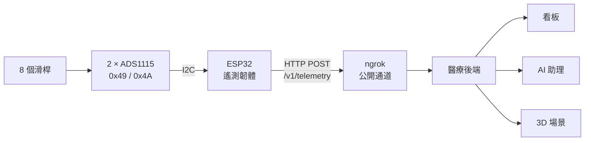
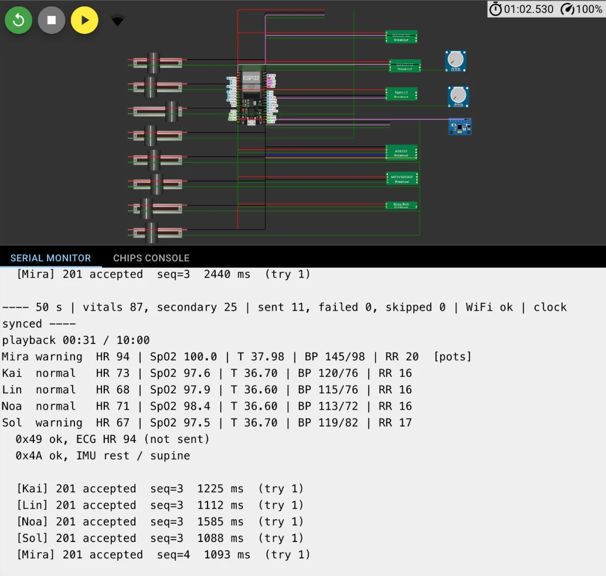

# 感測硬體、韌體與後端串接

[English](README.md) | 繁體中文

> 草稿 · 2026-11-15 · 作者：Abby（遙測閘道韌體與後端串接）· Samreena（電路設計、感測器選型與資料擷取）
>
> 第 2 節說明感測端：感測器選型、Wokwi 電路與感測韌體。第 3 節起說明 ESP32 閘道器怎麼把五位太空人的資料送到後端，再接上看板、AI 助理與 3D 場景。

---

## 展示影片

[](https://youtu.be/UoUgcF6R0Og)

YouTube 連結：https://youtu.be/UoUgcF6R0Og

影片示範 Wokwi 模擬中的硬體：ESP32 電路、滑桿與各個感測器模組，以及韌體在 Serial Monitor 上的執行過程，可以看到封包被後端接受（`201 accepted`）。影片中的數值都是模擬的測試輸入。

---

## 1. 概要

我們在 Wokwi 上模擬一塊 ESP32，代表太空艙裡的健康監測閘道器。它同時負責五位太空人（Mira、Kai、Lin、Noa、Sol）：讀取生理數值、在裝置端先判斷每一項是否異常，再把資料打包成 JSON，透過 HTTP 送到 Akira 的醫療後端。後端再把資料提供給看板、AI 助理和 3D 場景使用。

所有讀值都是模擬的。Wokwi 電路上的滑桿是可調整的測試輸入，代表其中一位太空人（目前是 Mira）；其他四位播放資料組產生的 10 分鐘測試資料（dataset-v2）。這些數值用來驗證資料路徑，不是真正的生理量測，封包裡也一律標成合成資料。

---

## 2. 感測硬體與資料擷取

### 2.1 設計方向與感測器選型

這部分涵蓋裝置端的感測路徑：挑選感測元件、在 Wokwi 建立 ESP32 電路，以及擷取和處理輸入數值。設計採逐步開發：有實體感測器模型的就用模型，Wokwi 沒有的專業生醫元件則用模擬輸入代替。

| 參數 | 選用的感測器／做法 |
| --- | --- |
| 心率與血氧 | MAX30102 光學感測器 |
| 心電圖 | AD8232 心電前端模組 |
| 體溫 | TMP117 數位溫度感測器 |
| 動作 | MPU6050 加速度計與陀螺儀 |
| 血壓 | 規劃中的壓力感測子系統；壓力感測器需要搭配壓脈帶和量測演算法 |
| 呼吸動作 | 呼吸帶或合適的動作感測器 |

MAX30102 可估算脈搏和血氧，AD8232 處理心電訊號，TMP117 提供數位體溫量測，MPU6050 量測動作。血壓和呼吸動作需要各自的感測方式和處理流程。這些都是成熟的感測器，本專案的貢獻在於把它們整合進同一套嵌入式系統。

### 2.2 電路設計與 Wokwi 模擬

ESP32 DevKit C v4 是主控制器。Wokwi 電路上有八個滑桿，透過兩顆 ADS1115 類比數位轉換器（I²C 位址 0x49、0x4A）讀取；另有兩顆旋鈕直接接在 GPIO 35 和 GPIO 36，用 ESP32 內建 ADC 讀取。TMP117 等數位元件使用各自的數位介面，I²C 裝置以不同位址共用同一條匯流排。

滑桿是可調整的測試輸入，用來驗證擷取和處理的韌體。它們在模擬中代替感測器訊號，不是真正的生醫量測。Wokwi 沒有提供的專業感測器，可以用測試輸入或軟體產生的數值代替。這樣能驗證軟體的資料路徑，但無法驗證實體感測器或生理量測的準確度。

### 2.3 感測韌體與資料處理

感測韌體從 TMP117、兩顆 ADS1115、兩個直接類比輸入和其他支援的感測介面讀取數值，把原始讀值換算成各參數的數值，加上單位和相關資訊，並檢查每筆讀值是否可用。模擬或軟體產生的數值會一直標示清楚，不會被當成實體感測器的讀值。

健康檢查使用團隊的門檻表（見 4.4 節），把讀值分成 normal、warning、critical：

- 比較前先把數值四捨五入到表上的精度。
- 用 45 個臨界值測試，結果全部一致。
- 另有一條「心跳過快」規則：休息時心率超過 110 bpm 持續 3 秒就觸發。
- CO₂ 和疲勞因為門檻表沒有定義範圍，目前只是佔位分類。

睡眠時間不由韌體量測，而是手動輸入，跟即時感測資料分開處理。

### 2.4 範圍

本專案的特色是把多種感測方式整合在同一個 ESP32 平台上：Wokwi 原型、透過兩顆 ADS1115 的類比擷取、依參數的初步健康分類，以及依照固定 schema 交給後端的 JSON（見第 5–6 節）。明確的品質和來源資訊，讓後端能分辨可用的讀值和缺漏、無效或模擬的數值。本專案不宣稱發明新的感測器，也不提供經臨床驗證的診斷。

---

## 3. 資料流程



1. 滑桿的電壓經過 ADS1115 轉成數字，ESP32 透過 I2C 讀取，再換算成生理數值（例如心率 30–180 /min）。
2. ESP32 對每一項指標判斷 normal、warning 或 critical。
3. 每位太空人各自組成一個 JSON 封包，用自己的裝置 ID 和 Token 送出。
4. Wokwi 在雲端執行，連不到後端電腦的區網，所以後端用 ngrok 開一個公開入口。
5. 後端驗證封包、存起來，再做綜合判斷，提供給看板、AI 助理和 3D 場景。

---

## 4. 韌體架構

程式碼：[`sketch.ino`](sketch.ino)（Arduino 框架，ESP32 DevKit C v4）。

### 4.1 FreeRTOS 任務

| 任務 | 優先權 | 週期 | 工作內容 |
| --- | --- | --- | --- |
| `vitalsTask` | 2（高） | 0.5 s | 讀滑桿；讀心率、血氧、體溫、血壓並判斷；記下讀值時間 |
| `secondaryTask` | 1 | 2 s | 讀呼吸頻率並判斷；每 10 秒印狀態摘要 |
| `transmitTask` | 1 | 每包間隔 1 s | 檢查 Wi-Fi 與校時 → 五人輪流組 JSON → 送出、重送 |

- 兩把 mutex（互斥鎖）：`dataMutex` 保護五人的資料，`serialMutex` 讓 Serial 輸出不會互相穿插。
- 傳送時先複製一份資料快照再放開鎖，所以網路慢的時候不會卡住讀值任務。
- 只有 `vitalsTask` 使用 I2C，避免兩個任務同時操作匯流排。

### 4.2 感測器抽象層

主程式只呼叫 `readVitals(i, sample)` 和 `readRespiratoryRate(i)`，不需要知道數值從哪裡來。電路代表的太空人讀滑桿；其他人，或滑桿晶片沒回應的項目，播放測試資料（`crew_data.h`）。以後換成實體感測器，只要改這些函式的內容。

滑桿是感測器訊號的替代品，下表是韌體把滑桿位置換算成數值的範圍。例如體溫滑桿代表 TMP117 的讀值。GPIO 35 / 36 的兩個旋鈕（CO₂、疲勞）目前沒有門檻，閘道器不會送出。

| 滑桿 | ADS1115 | 範圍 |
| --- | --- | --- |
| 體溫 | 0x49 A0 | 34–41 Cel |
| 心率 | 0x49 A1 | 30–180 /min |
| 血氧 | 0x49 A2 | 70–100 % |
| ECG 心率 | 0x49 A3 | 30–180 /min（只顯示） |
| 收縮壓 | 0x4A A0 | 70–200 mm[Hg] |
| 舒張壓 | 0x4A A1 | 40–120 mm[Hg] |
| IMU 姿勢 | 0x4A A2 | 躺／坐站／活動（只顯示） |
| 呼吸頻率 | 0x4A A3 | 4–40 /min |

### 4.3 測試資料播放

- 資料組的 dataset-v2 有一段 10 分鐘、每秒一筆的即時資料。[`tools/make_crew_data.py`](tools/make_crew_data.py) 把它轉成 [`crew_data.h`](crew_data.h)（只留數字），ESP32 從「開始送資料」那一刻開始播放，播完從頭再來。
- 每一筆帶有品質：`good`、`poor`（動作干擾 `motion_artifact`）、`missing`（沒讀到 `no_sample`，`value` 送 `null`、不做判斷）。
- 心率的 `context.activity` 跟著資料走，例如 Kai 運動時是 `exercise`。
- 體溫、血壓每分鐘量一次，有新的量測才放進封包。
- 時間戳記（`observedAt`）和序號（`seq`）用真實時間繼續往前，所以重播不會跟舊資料衝突。

### 4.4 裝置端異常判斷

閘道器用團隊的門檻表，對每一項指標各自分成 normal、warning、critical，結果放在該指標的 `context.deviceAlert`。綜合判斷（例如多項指標一起看）由後端負責。

感測韌體用同一張門檻表，另外有四捨五入和「心跳過快」規則（見 2.3 節）。閘道器目前只做每次讀值的單項判斷。

| 指標 | normal | warning | critical |
| --- | --- | --- | --- |
| 心率 (/min) | 60–100 | 40–59, 101–149 | < 40, ≥ 150 |
| 血氧 (%) | ≥ 95 | 93–94 | < 93 |
| 呼吸頻率 (/min) | 12–20 | 9–11, 21–29 | < 9, ≥ 30 |
| 收縮壓 (mm[Hg]) | 100–120 | 90–99, 121–179 | < 90, ≥ 180 |
| 舒張壓 (mm[Hg]) | 60–80 | 50–59, 81–109 | < 50, ≥ 110 |
| 體溫 (Cel) | 36.5–37.5 | 35.0–36.4, 37.6–38.9 | < 35.0, ≥ 39.0 |

> 注意：這些門檻是軟體測試用的數值，不是 NASA 正式的醫療警示標準。這是原型的監測指標，不是經過臨床驗證的診斷系統。

---

## 5. 封包格式

依照後端的 schema 1.3，單位使用 UCUM（`/min`、`%`、`Cel`、`mm[Hg]`）。每位太空人一包，以下是 Mira 的範例（實際送出時是一整行）：

```json
{
  "schemaVersion": "1.3",
  "messageId": "mock-mira:boot-0be2b5e3:1",
  "runId": null,
  "deviceId": "mock-mira",
  "assignmentId": "assignment-mira",
  "bootId": "boot-0be2b5e3",
  "seq": 1,
  "observedAt": "2026-11-15T02:00:00.123Z",
  "deviceUptimeMs": 15234,
  "clockStatus": "synced",
  "mode": "training",
  "source": "mock",
  "dataOrigin": "synthetic",
  "transport": "http",
  "isSynthetic": true,
  "upstreamSampleId": "mock-mira:boot-0be2b5e3:1",
  "deliveryKind": "live",
  "metrics": [
    { "code": "heart_rate", "value": 92, "unit": "/min", "method": "mock_generated",
      "context": { "activity": "rest", "deviceAlert": "normal" }, "quality": "good" },
    { "code": "spo2", "value": 99.6, "unit": "%", "method": "mock_generated",
      "context": { "measurementSite": "finger", "deviceAlert": "normal" }, "quality": "good" },
    { "code": "temperature", "value": 37.94, "unit": "Cel", "method": "mock_generated",
      "context": { "measurementSite": "oral", "temperatureType": "oral", "sensor": "TMP117", "deviceAlert": "warning" },
      "quality": "good" },
    { "code": "blood_pressure_systolic", "value": 146, "unit": "mm[Hg]", "method": "mock_generated",
      "context": { "posture": "seated", "deviceAlert": "warning" },
      "measurementGroupId": "mock-mira:boot-0be2b5e3:1:bp", "quality": "good" },
    { "code": "blood_pressure_diastolic", "value": 98, "unit": "mm[Hg]", "method": "mock_generated",
      "context": { "posture": "seated", "deviceAlert": "warning" },
      "measurementGroupId": "mock-mira:boot-0be2b5e3:1:bp", "quality": "good" },
    { "code": "respiratory_rate", "value": 21, "unit": "/min", "method": "mock_generated",
      "context": { "observationDuration": 60, "deviceAlert": "warning" }, "quality": "good" },
    { "code": "work_of_breathing", "value": null, "unit": "1", "method": "mock_generated",
      "context": {}, "quality": "missing", "qualityReason": "scale_not_configured" }
  ]
}
```

- `messageId` = 裝置 ID : 開機 ID : 序號。`bootId` 每次開機隨機產生，`seq` 每包新資料加 1。後端用這些來辨認重複的封包。
- `observedAt` 是讀值當下的 UTC 時間（透過 NTP 校時）。
- 收縮壓和舒張壓放在同一包，共用 `measurementGroupId`。
- 呼吸費力程度還沒有確定的量表，所以送「缺值」，原因是 `scale_not_configured`。缺少的讀值都會明確標出來，不會直接省略。
- `dataOrigin` 說明資料從哪裡來，`isSynthetic` 說明是不是人工產生的，兩個欄位互補。Wokwi 的數值一律是 `synthetic` / `true`。
- 單位一律用 UCUM。後端的驗證很嚴格，1.3 版會拒收 `bpm`、`mmHg` 這類寫法，所以一定要用表上的代碼。

---

## 6. 傳送與可靠性

| 機制 | 做法 |
| --- | --- |
| 加密 | 目前用 HTTP（見第 9 節）。程式也支援 HTTPS 和根憑證驗證（`setCACert` + ISRG Root X1），改網址就能切換 |
| 身分驗證 | 每位太空人各自的 Bearer Token；裝置 ID、綁定 ID、Token 必須配對 |
| 校時 | 三個 NTP 伺服器；時間沒對好前不送（後端拒收 `unsynced`） |
| 重送 | 連線失敗或 408／429／5xx 時，原封不動重送，最多 3 次（等待 0.25 s、0.5 s） |
| 防止重複 | 重送的封包內容完全相同，後端回 `200 replayed`，不會重複計算 |
| 成功判斷 | `201` 且 `status = accepted`，或 `200` 且 `replayed = true` |
| 錯誤 | 400／401／403／409／422 不重送，Serial 印出後端回覆的錯誤原因 |
| 斷線 | Wi-Fi 斷線自動重連；讀值任務照常執行 |

---

## 7. 在 Wokwi 執行

1. 開啟 Wokwi 專案（含 ADS1115 滑桿電路），把 `sketch.ino` 換成本專案的版本。另外新增一個分頁 `crew_data.h`，貼上本專案的同名檔案。
2. Token 不放在公開的程式碼裡。執行前，在 `DEVICE_TOKENS[]` 把 `PASTE-…-TOKEN-HERE` 換成後端負責人私下提供的 Token。
3. 按綠色執行鍵，**不要存檔**，這樣公開的版本永遠不會有 Token。
4. 拖動滑桿，每 10 秒的狀態摘要會顯示 Mira 的最新數值和判斷。

預期的 Serial 輸出：

```text
=== Astro Hiyoko telemetry gateway ===
token : Mira ok, Kai ok, Lin ok, Noa ok, Sol ok
[ADS] 0x49 ok, using pots
[ADS] 0x4A ok, using pots
[WiFi] connected, IP 10.10.0.2
[playback] start, 10 min loop
  [Kai] 201 accepted  seq=1  1195 ms  (try 1)
...
playback 04:13 / 10:00
Mira warning  HR 93 | SpO2 100.0 | T 37.91 | BP 147/97 | RR 21  [pots]
Kai  normal   HR 86 (exercise) | SpO2 97.2 | T 36.70 | BP 120/76 | RR 16
Sol  warning  HR -- (missing) | SpO2 -- (missing) | T 36.70 | BP 119/82 | RR 15
```

---

## 8. 驗證結果

| 項目 | 結果 |
| --- | --- |
| 滑桿讀值、裝置端判斷 | Wokwi 已驗證 |
| Wi-Fi、NTP 校時 | Wokwi 已驗證 |
| 傳送與重送（測試伺服器） | 用 httpbin 驗證 |
| 送到後端 `201 accepted` | 2026-11-15：五位太空人都收到 `201 accepted`，每包約 0.9–1.2 秒 |
| 播放 dataset-v2（品質、運動） | 2026-11-15：Kai 2:00 起 `exercise`、Sol 4:03 `poor`、4:13 `missing`（`value: null`）都收到 `201 accepted` |



---

## 9. 限制與未來工作

- **全部是模擬資料**：沒有實體電路。比賽時間內來不及採購、組裝和除錯硬體。
- **測試資料沒有緊急情境**：dataset-v2 最嚴重只到 warning；要展示 critical，要拉 Mira 的滑桿。
- **血壓**：實體的壓力感測需要袖帶和量測演算法才能算出收縮壓和舒張壓，目前只用滑桿代表結果。
- **呼吸費力程度**：量表還沒定，目前送缺值。
- **頻率**：五人輪流送，實測每包約 1 秒、每包間隔 1 秒，所以每人約 10 秒一包。展示影片用預錄畫面，所以不需要每秒一包；之後可以重複使用連線來加快。
- **加密**：在 Wokwi 上用 HTTPS 連 ngrok 時，ESP32 每次都在加密握手階段被斷線（mbedTLS -29312），關掉憑證驗證、換成很輕的專案都一樣。因為資料全是模擬的，後端負責人同意改用 HTTP，代價是 Token 以明文傳送，比賽後會更換 Token。實體裝置應改回 HTTPS 並驗證憑證。
- **補傳**：連續失敗的封包目前會丟掉，之後可以先存起來，網路恢復後補傳（`backfill`）。
